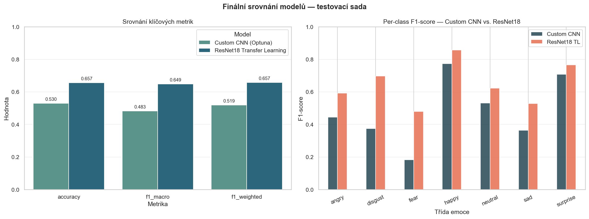
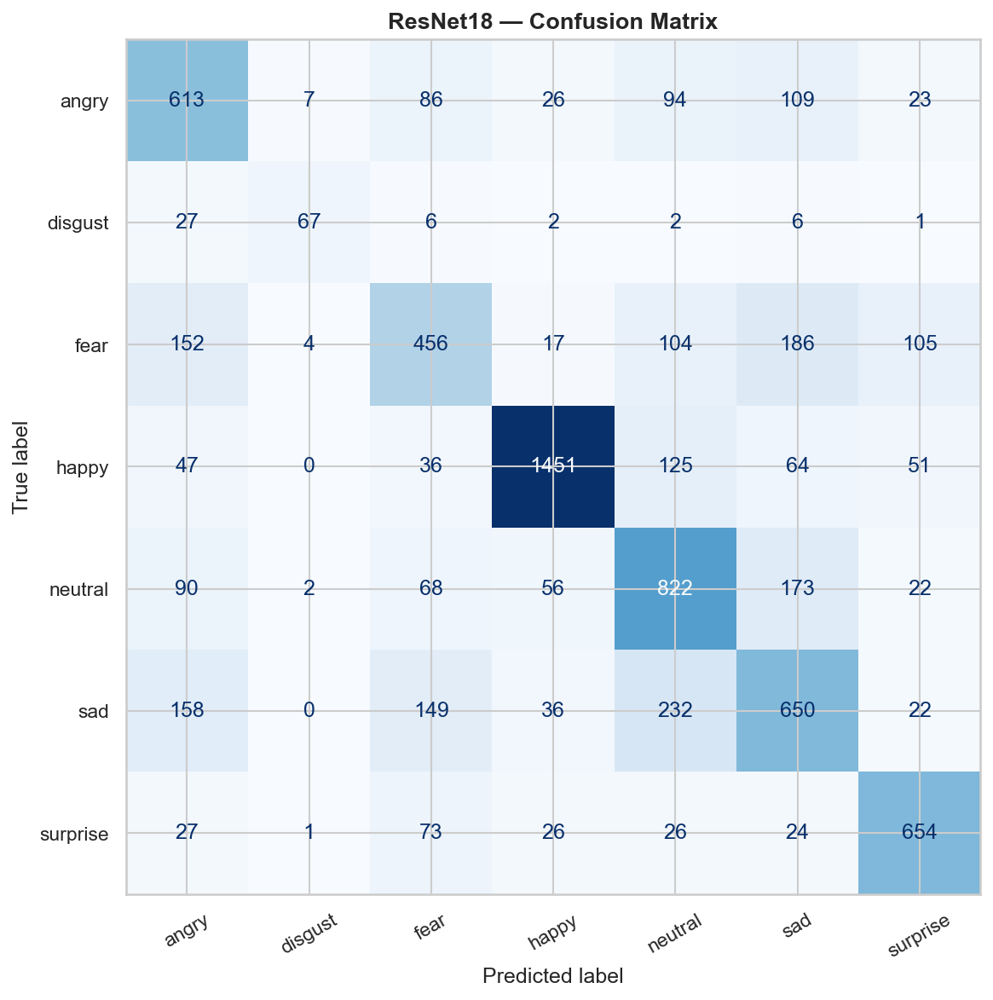
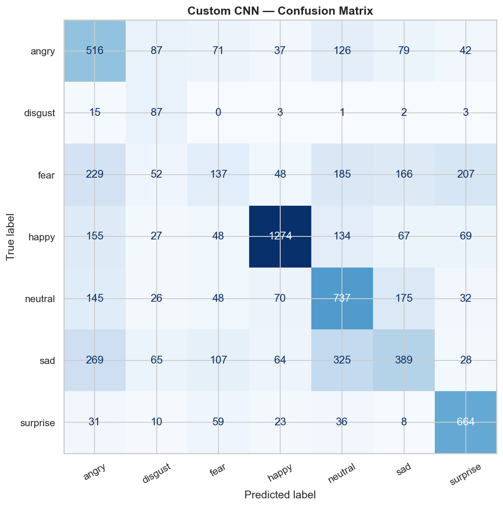
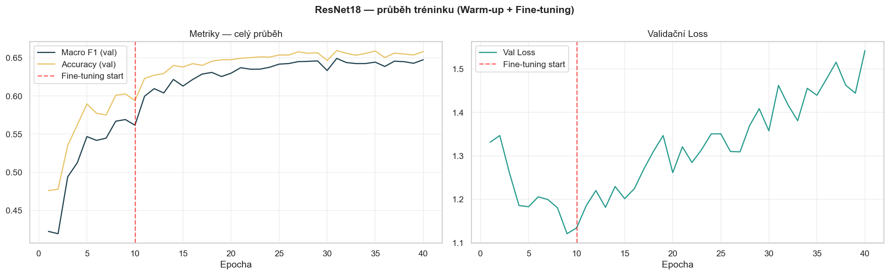

# Facial Emotion Recognition on FER-2013 (PyTorch → ONNX)

7-class facial expression recognition on the FER-2013 dataset. A custom CNN tuned with Optuna is compared against a fine-tuned ResNet18. Both models are exported to ONNX and served through a small ONNX Runtime inference class. The dataset is heavily imbalanced, so **Macro F1** is the primary metric throughout, not accuracy.

**Highlights**

- Class-imbalance handling: class-weighted cross-entropy plus a `WeightedRandomSampler`
- Augmentations chosen for faces, with a written rationale for what was included and excluded
- Optuna hyperparameter search (TPE sampler, median pruner) for the custom CNN
- Two-stage transfer learning (warm-up, then full fine-tuning with layer-wise learning rates)
- ONNX export with a dynamic batch axis, validated with `onnx.checker`, and an `onnxruntime` inference class

## Results (test set, 7,178 images)

| Model | Accuracy | Macro F1 | Weighted F1 | Macro Precision | Macro Recall |
|---|---|---|---|---|---|
| Custom CNN (Optuna) | 0.5300 | 0.4829 | 0.5191 | 0.4725 | 0.5547 |
| **ResNet18 (transfer learning)** | **0.6566** | **0.6491** | **0.6575** | **0.6663** | **0.6402** |

ResNet18 beats the custom CNN in every class. The largest per-class F1 gains are on `disgust` (0.37 → 0.70) and `fear` (0.18 → 0.48). `fear`, `sad` and `neutral` remain the hardest classes for both models.

> Some plot titles and axis labels below are in Czech (the original language of the project). The confusion matrices are fully in English.



| ResNet18 confusion matrix | Custom CNN confusion matrix |
|---|---|
|  |  |



## Dataset

[FER-2013](https://www.kaggle.com/datasets/msambare/fer2013): 48×48 grayscale face images in 7 classes (angry, disgust, fear, happy, neutral, sad, surprise). It has 28,709 training images and 7,178 test images. The classes are strongly imbalanced: `happy` has 7,215 training images and `disgust` has 436.

The dataset is **not included** in this repository. Download it from Kaggle (`msambare/fer2013`, the image-folder version) and extract it into a folder called `archive/` next to the notebook. The notebook reads the data with `torchvision.datasets.ImageFolder` and expects this layout:

```
archive/
├── train/
│   ├── angry/  disgust/  fear/  happy/  neutral/  sad/  surprise/
└── test/
    ├── angry/  disgust/  fear/  happy/  neutral/  sad/  surprise/
```

With the Kaggle CLI:

```bash
kaggle datasets download -d msambare/fer2013
unzip fer2013.zip -d archive
```

## Approach

1. **EDA and metric choice.** Class counts are explored, and the notebook explains why accuracy is misleading on this dataset and Macro F1 is not.
2. **Imbalance handling.** `compute_class_weight("balanced")` weights feed `CrossEntropyLoss`. The training loader uses a `WeightedRandomSampler`, so each mini-batch is roughly class-balanced.
3. **Augmentation.** Training uses horizontal flips, ±15° rotation, 10% translation and brightness/contrast jitter. Vertical flips, large cut-outs and strong grid distortion are excluded on purpose because they destroy facial cues.
4. **Custom CNN.** Three double-conv blocks (Conv–BN–ReLU ×2, MaxPool, Dropout2d) feed into global average pooling and an MLP head, for about 296k parameters. Optuna searches the number of filters, dropout, learning rate and batch size, maximizing validation Macro F1. The best configuration is then trained for 40 epochs with `ReduceLROnPlateau`.
5. **Transfer learning.** An ImageNet-pretrained ResNet18 gets a new classification head. Grayscale images are upscaled to 224×224 and replicated into 3 channels. Training runs in two phases. First, a 10-epoch warm-up trains only `layer4` and the head. Second, the whole network is fine-tuned for 30 epochs with AdamW, layer-wise learning rates (1e-5 to 1e-4) and cosine annealing.
6. **Model selection.** The checkpoint with the best validation Macro F1 is kept, then evaluated once on the test set.
7. **Deployment.** Both models are exported to ONNX (opset 17, dynamic batch axis) and checked with `onnx.checker`. A `FERInference` class wraps `onnxruntime` and handles preprocessing, softmax and batch prediction. A final demo runs both models on arbitrary photos, using an OpenCV Haar cascade to crop the face.

## How to run

```bash
python -m venv .venv
source .venv/bin/activate        # Windows: .venv\Scripts\activate
pip install -r requirements.txt
pip install jupyter
jupyter notebook fer2013_emotion_classification.ipynb
```

Running the whole notebook retrains both models. A GPU is strongly recommended for the ResNet18 part. The custom-photo demo at the end reads from a `My_imgs/` folder. That folder is not included, so add your own `.png`, `.jpg` or `.jpeg` photos to it to try the demo.

### ONNX inference with the included model

The exported custom CNN is included at `models/fer2013_Custom_CNN.onnx` (1.2 MB). It takes input `input` with shape `[batch, 1, 48, 48]` and returns `logits` with shape `[batch, 7]`. The ResNet18 ONNX file (~44 MB) is not included, but the notebook regenerates it.

Using the notebook's `FERInference` class:

```python
predictor = FERInference("models/fer2013_Custom_CNN.onnx", is_transfer_learning=False)
emotion, probs = predictor.predict("face.jpg")
print(emotion, probs[emotion])
```

Or standalone, with only `onnxruntime`, `numpy` and `Pillow`:

```python
import numpy as np
import onnxruntime as ort
from PIL import Image

CLASSES = ["angry", "disgust", "fear", "happy", "neutral", "sad", "surprise"]
session = ort.InferenceSession("models/fer2013_Custom_CNN.onnx", providers=["CPUExecutionProvider"])

img = Image.open("face.jpg").convert("L").resize((48, 48), Image.BILINEAR)
x = (np.asarray(img, dtype=np.float32) / 255.0 - 0.5) / 0.5   # same normalization as training
x = x[np.newaxis, np.newaxis, :, :]                            # (1, 1, 48, 48)

logits = session.run(["logits"], {"input": x})[0][0]
probs = np.exp(logits - logits.max()); probs /= probs.sum()
print(CLASSES[int(probs.argmax())], float(probs.max()))
```

The model was trained on tightly cropped faces, so crop the face first for best results (the notebook's demo uses a Haar cascade).

## Repository structure

```
fer2013-emotion-recognition/
├── fer2013_emotion_classification.ipynb   # full pipeline: EDA → training → evaluation → ONNX → inference
├── models/
│   └── fer2013_Custom_CNN.onnx            # exported custom CNN (ResNet18 ONNX not included, ~44 MB)
├── images/                                # plots used in this README
├── requirements.txt
└── README.md
```

`archive/` (the dataset) and `My_imgs/` (your own photos) are expected locally but are not part of the repository.

## Tech stack

PyTorch, torchvision, Optuna, scikit-learn, ONNX, ONNX Runtime, OpenCV, pandas, matplotlib, seaborn.
